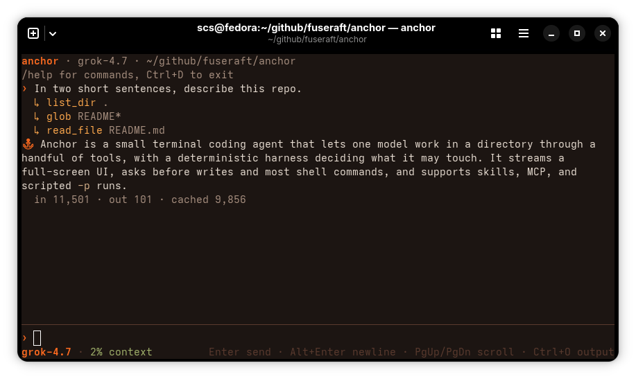

# anchor

[](https://github.com/fuseraft/anchor/actions/workflows/ci.yml)
[](https://github.com/fuseraft/anchor/releases)
[](LICENSE)

A small coding agent for the terminal. Bring your own key and your own model: it works in one
directory through a handful of tools, and a deterministic harness decides what it may touch.

**Documentation: [fuseraft.ai/anchor](https://fuseraft.ai/anchor/)**



- **Your model, your key.** Claude, OpenAI and xAI, or any server that speaks the OpenAI API:
  your company's LLM gateway, OpenRouter, a LiteLLM proxy, or a local model in Ollama, vLLM or LM
  Studio. Name a server once and use its models as `work/<model>`; switch with `/model` mid-session.
  Set how hard the model thinks with `/effort`, and watch its thinking as it streams.
- **Safe by default.** Writes, most shell commands and reads outside the directory ask first, with
  a diff for every write. Secret files and dangerous commands are always denied, even with `--yolo`.
  An "always" answer is remembered per directory, in `~/.anchor`.
- **Full-screen terminal UI.** Streaming Markdown with highlighted code, `@path` attachments,
  search, history and `/copy`. `--plain` gives a line-by-line REPL.
- **Themes.** Built-in themes, [sample themes](themes/) and your own in small JSON files, with
  hex colors and full-screen backgrounds.
- **Long sessions.** Older turns are summarized to fit the context window. Sessions resume, and
  `/undo` reverts a turn's file changes.
- **Extensible.** Sub-agents, Agent Skills and MCP servers, all behind the same approval checkpoint.
- **Scriptable.** `-p` runs one prompt, `--json` streams events, and `--until` keeps going until a
  check passes.

Status: 0.10.0. Linux, macOS and Windows (shell commands run in Git for Windows' bash).

## Install

```sh
curl -fsSL https://raw.githubusercontent.com/fuseraft/anchor/main/install.sh | bash   # Linux, macOS
irm https://raw.githubusercontent.com/fuseraft/anchor/main/install.ps1 | iex          # Windows (PowerShell)
brew install fuseraft/tap/anchor                                                     # Homebrew
```

Or use Scoop (`scoop bucket add fuseraft https://github.com/fuseraft/scoop-bucket`, then
`scoop install anchor`), grab a [release](https://github.com/fuseraft/anchor/releases), or build with
`./build.sh` (.NET 10 SDK). Script installs update themselves; see
[Install](https://fuseraft.ai/anchor/start/install/).

## Configure

Run `anchor setup`. It asks where your models come from (Anthropic, OpenAI, xAI, or your own
server's URL), keeps the key in your OS keychain where there is one, and lets you pick a model.

To use more than one server, such as your team's gateway and a model on your laptop, name each in
`~/.anchor/config.json`. See [Configuration](https://fuseraft.ai/anchor/start/configuration/) for
named providers, local servers, custom headers and reasoning effort.

## Use

```sh
anchor                                   # interactive
anchor --resume                          # continue the latest session here
anchor -p "why does the build fail?"
git diff | anchor -p "review this change"
anchor -p --yolo "fix the failing tests" --until "dotnet test"
```

In the REPL, `/help` lists the commands, `!cmd` runs a command in your own shell, and Ctrl+C
cancels a turn. `AGENTS.md` in the directory is added to the system prompt.

## Themes

`/theme` lists the themes and switches between them: `default`, `bright`, `light`, `mono` and
`rust` are built in. For more, copy one of the [sample themes](themes/) (ember, tide, forest, neon,
phosphor, paper) into `~/.anchor/themes/`:

```sh
mkdir -p ~/.anchor/themes
curl -fsSL https://raw.githubusercontent.com/fuseraft/anchor/main/themes/ember.json -o ~/.anchor/themes/ember.json
```

Then `/theme ember`, or `"theme": "ember"` in the config. `/theme save <name>` writes the current
colors to a file to start your own; [Making a theme](https://fuseraft.ai/anchor/guides/themes/)
explains the format.

## Learn more

[Safety](https://fuseraft.ai/anchor/guides/safety/) ·
[Work until a check passes](https://fuseraft.ai/anchor/guides/until/) ·
[Sub-agents](https://fuseraft.ai/anchor/guides/sub-agents/) ·
[Skills](https://fuseraft.ai/anchor/guides/skills/) ·
[MCP](https://fuseraft.ai/anchor/guides/mcp/) ·
[Scripting](https://fuseraft.ai/anchor/guides/scripting/) ·
[JSON protocol](https://fuseraft.ai/anchor/reference/json/) ·
[Commands](https://fuseraft.ai/anchor/reference/commands/)

## Develop

`DESIGN.md` explains how anchor is put together and why. `./build.sh` runs the tests and publishes
`bin/anchor`; `dotnet test` runs just the tests (they need `git` and `python3`). The docs site in
`docs/` is built with [Starlight](https://starlight.astro.build): `npm install && npm run dev` there
to preview, and pushes to `main` deploy it.

## License

MIT
